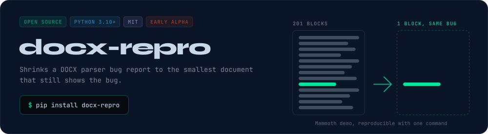

&nbsp;
&nbsp;
&nbsp;

 

## <samp>// about</samp>

I'm **Justine**, a web developer in the Philippines who builds things that don't just look good. They actually *do something*.

I build around the jobs people need done: students turning notes into practice, store owners tracking stock, job seekers tailoring resumes, and creators selling their work.

Every project I ship is a complete system, from the database schema to the deployed URL. I own the full stack, the full cycle and the full outcome.

Right now I'm an Associate Software Developer at Thrive Dynamic Business Solutions, working in Python and FastAPI on AI features, and I'm building [Resumiq](https://resumiq.tech).

 

## <samp>// deployed systems</samp>

Every system above is live. Full case studies on <a href="https://capt1nedev.vercel.app/#projects">capt1nedev.vercel.app</a>.

## <samp>// open source</samp>

[**docx-repro**](https://github.com/capt1nedev/docx-repro) is an MIT-licensed tool I maintain. Give it a document and a checker for your exact symptom, and it deletes body blocks until only the part that reproduces the bug is left. The initial implementation was developed with Codex assistance and validated with tests and real parser reproductions.

[Run the demo](https://github.com/capt1nedev/docx-repro#runnable-example-missing-text-in-mammoth) · [Read a real bug investigation](https://github.com/capt1nedev/docx-repro/blob/v0.1.2/docs/case-study-2323.md) · [Walkthrough](https://gist.github.com/capt1nedev/6946abc2bbd08ead1f8f26c68e16d1c7) · [PyPI](https://pypi.org/project/docx-repro/) · [Share a case](https://github.com/capt1nedev/docx-repro/issues)

**Pull requests upstream**

- [`kucherenko/jscpd#1158`](https://github.com/kucherenko/jscpd/pull/1158) fix(action): propagate scanner exit status
- [`kucherenko/jscpd#1157`](https://github.com/kucherenko/jscpd/pull/1157) fix(html-reporter): declare finder runtime dependency
- [`matthewwithanm/python-markdownify#284`](https://github.com/matthewwithanm/python-markdownify/pull/284) Bound table colspan parsing before integer conversion

## <samp>// installed modules</samp>

   
   
  

  <code>OpenAI</code> <code>NextAuth</code> <code>Paddle</code> <code>Stripe</code> <code>GCash</code> <code>Resend</code> <code>Oracle</code> <code>Upstash</code> 
  <code>PDF.js</code> <code>Mammoth</code> <code>Tesseract.js</code> <code>ZXing</code> <code>Leaflet</code> <code>Playwright</code> <code>Zod</code>

## <samp>// experience log</samp>

**Associate Software Developer** · Thrive Dynamic Business Solutions, Inc. · <samp>Jul 2025 – now</samp> 
Backend APIs in Python and FastAPI for an AI-powered feature inside enterprise apps. Oracle and MongoDB integration, agent-based workflow automation.

**Back End Developer, intern** · Thrive Dynamic Business Solutions, Inc. · <samp>Apr – Jul 2025</samp> 
Built a new feature from scratch on a small backend team, pulling dynamic data from several databases.

**Web Developer** · Self-employed · <samp>Dec 2023 – Mar 2025</samp> 
Client and self-directed projects across tourism, commerce and SaaS, including Explore Naga City and GadgetOne.

## <samp>// telemetry</samp>

<picture>
  <source media="(prefers-color-scheme: dark)" srcset="https://raw.githubusercontent.com/capt1nedev/capt1nedev/output/snake-dark.svg" />
  <source media="(prefers-color-scheme: light)" srcset="https://raw.githubusercontent.com/capt1nedev/capt1nedev/output/snake.svg" />
  
</picture>

  

